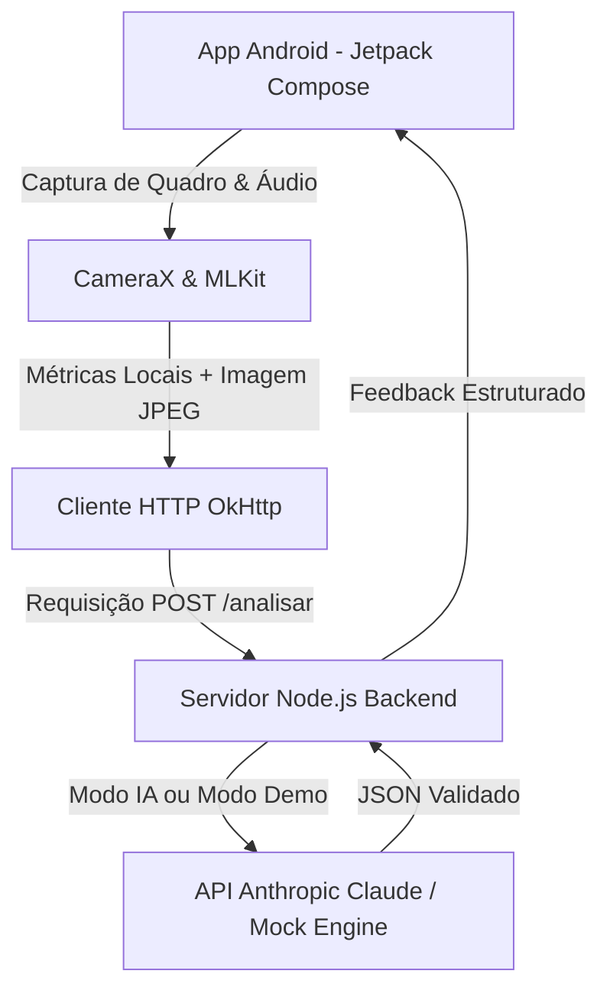

<div align="center">

# 🧠 Alphayat — Sistema de Análise de Imagens e Apresentações
### Desenvolvido pelo **Grupo Percepta** 🚀

<p align="center">
  
  
  
</p>

<p align="center">
  <b>Transformando a comunicação e a presença pessoal através de Inteligência Artificial Multimodal e Visão Computacional.</b>
</p>

---

### ⚡ Tecnologias & Stack
<p align="center">
  
  
  
  
  
  
</p>

</div>

---

## 📌 Sobre o Projeto

O **Alphayat** é um assistente inteligente de feedback para apresentações pessoais e profissionais. Utilizando a câmera do dispositivo em conjunto com algoritmos de Machine Learning no *edge* (dispositivo) e modelos multimodais na nuvem, o aplicativo analisa instantaneamente três pilares fundamentais da comunicação:

1. **🧍 Postura & Pose:** Detecção de alinhamento de ombros, inclinação corporal e linguagem corporal (via Google MLKit Pose Detection).
2. **👔 Roupa & Apresentação:** Avaliação de adequação visual e contraste de vestimenta.
3. **🎙️ Tom de Voz:** Análise de ritmo, volume, pausas e variação de tom capturados pelo microfone em tempo real.

---

## 🛠️ Arquitetura do Sistema



---

## 🚀 Como Executar a Demonstração

### 1️⃣ Iniciar o Backend (Servidor de Análise)
O backend possui suporte a **Modo Demonstrativo (Demo Mode)** integrado: funciona perfeitamente para testes sem exigir chaves de API externas.

```bash
cd backend
# Opcional: defina sua chave se quiser usar o Claude real
# set ANTHROPIC_API_KEY=sua_chave_aqui
node --experimental-fetch servidor.js
```
> O servidor iniciará em `http://localhost:8787/analisar`.

### 2️⃣ Executar o Aplicativo Android
1. Abra o projeto no **Android Studio**.
2. Conecte um celular físico via USB ou inicie um AVD (Emulador).
3. Clique em **Run ▶️** (`Shift + F10`) para compilar e instalar o app (`app-debug.apk`).

---

## 🛡️ Privacidade e Segurança
- O **Alphayat** respeita rigorosamente a privacidade do usuário:
- O áudio bruto **nunca** deixa o aparelho (apenas métricas matemáticas calculadas localmente são enviadas).
- Nenhuma imagem ou gravação é armazenada permanentemente no servidor ou no dispositivo.

---

<div align="center">
  <b>Grupo Percepta • Rumo ao Demo Day 🚀</b>
</div>
