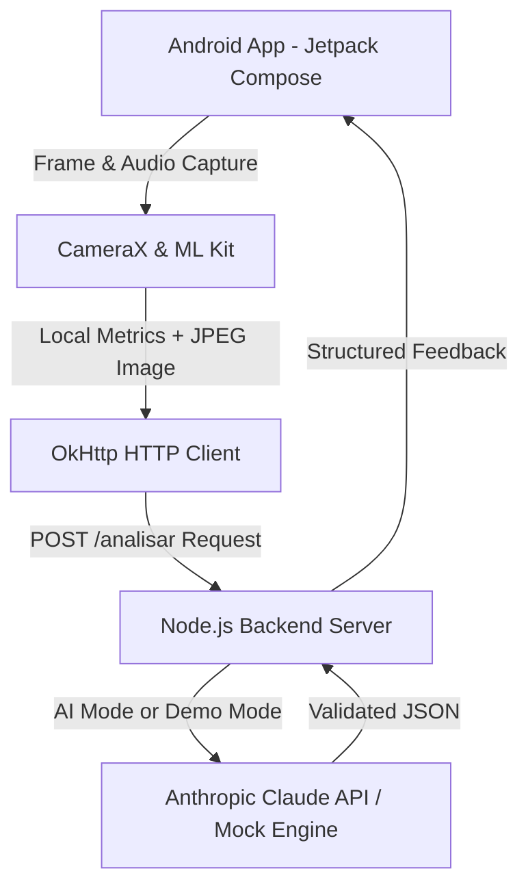

 <div align="center">

# Alphayat: Image & Presentation Analysis System
### Built with purpose.

<p align="center">
  
  
  
</p>

<p align="center">
  <b>Transforming communication and personal presence through Multimodal Artificial Intelligence and Computer Vision.</b>
</p>

---

### Technologies & Stack

<p align="center">
  
  &nbsp;&nbsp;
  
  &nbsp;&nbsp;
  
  &nbsp;&nbsp;
  
</p>

<p align="center">
  <b>Kotlin · Jetpack Compose · CameraX · Google ML Kit · Node.js · Anthropic Claude</b>
</p>

</div>

---

## About the Project

**Alphayat** is an intelligent feedback assistant designed to help users improve their personal and professional presentations.

By combining device camera capabilities, on-device Machine Learning algorithms, and cloud-based multimodal AI models, the application analyzes three fundamental aspects of communication:

1. **Posture & Body Language:** Detects shoulder alignment, body inclination, and posture patterns using Google ML Kit Pose Detection.
2. **Outfit & Appearance:** Evaluates visual presentation, clothing suitability, and outfit contrast.
3. **Voice & Delivery:** Analyzes speaking pace, volume, pauses, and pitch variations captured through the microphone in real time.

---

## System Architecture



---

## Running the Demo

### 1. Start the Backend (Analysis Server)

The backend includes an integrated **Demo Mode**, allowing the application to run and be tested without requiring external API credentials.

```bash
cd backend

# Optional: configure your API key to enable real Claude analysis
# set ANTHROPIC_API_KEY=your_api_key_here

node --experimental-fetch servidor.js
```

> The server will be available at `http://localhost:8787/analisar`.

### 2. Run the Android Application

1. Open the project in **Android Studio**.
2. Connect a physical Android device via USB or launch an AVD (Android Virtual Device).
3. Click **Run** (`Shift + F10`) to build and install the application (`app-debug.apk`).

---

## Privacy & Security

Alphayat prioritizes user privacy and data protection:

- **Audio never leaves the device:** Raw audio is processed locally. Only mathematically derived metrics are transmitted to the backend.
- **No permanent storage:** Images and audio recordings are not permanently stored on the device or server.
- **Local processing:** Sensitive audio analysis is performed directly on the device before any data transmission.

---

<div align="center">

**Percepta Team | On the Road to Demo Day**

</div>
